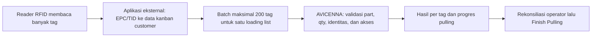

# API batch RFID delivery

Panduan integrasi aplikasi eksternal · sesuai implementasi 30 Oktober 2026.

Endpoint ini dipakai aplikasi eksternal yang membaca **kanban customer melalui RFID**. Satu tag adalah satu box. Qty ditentukan dari `qtyPerKanban` pada item loading list; aplikasi tidak mengirim qty dan tidak men-scan kanban internal pada endpoint ini. Alur barcode tiga arah di `POST /loading/scan` tetap berjalan seperti sebelumnya.

File pendamping: [koleksi Postman](postman/avicenna-delivery-rfid.postman_collection.json). Seluruh contoh ID, part, dan tag dalam panduan ini bersifat ilustratif; pilih data trial yang sesuai sebelum mengirim scan.

## Pembagian tanggung jawab



Reader/aplikasi eksternal bertanggung jawab menyediakan identitas tag yang stabil dan pasangan data kanban yang benar. AVICENNA mencocokkan part terhadap loading list, mengambil qty dari item, mencegah hitung ganda, dan menyimpan audit. API tidak menyediakan driver reader, konfigurasi antena, atau master pemetaan EPC ke part.

## Akses dan urutan pemakaian

Base URL lokal pengembangan: `http://localhost:3004`. Aplikasi pada komputer/perangkat lain harus memakai hostname/IP server yang dapat dijangkaunya; `localhost` menunjuk perangkat aplikasi tersebut.

Jika aplikasi eksternal berjalan di browser, origin-nya juga harus diizinkan melalui konfigurasi CORS `WEB_ORIGIN` pada server.

1. Ambil Bearer token melalui autentikasi AVICENNA. Pengguna harus berjenis role **ADMIN** atau **SCANNING**. Token device hanya boleh berasal dari **device RFID aktif** pada pabrik yang sama dengan loading list; pengguna non-admin juga dibatasi pabriknya.
2. Cari dokumen dengan `GET /loading/resolve?code=<manifest/loading-list/PDS>`. Pilih `matches[].id` bila ada beberapa kandidat.
3. Baca `GET /loading/<id>` untuk menampilkan item, part customer, qty per box, target, dan progres.
4. Kirim hasil pembacaan melalui endpoint batch di bawah. Untuk lebih dari 200 tag, pecah menjadi beberapa request dengan `tagId` tetap sama.
5. Periksa hasil **setiap tag**, lalu refresh detail dokumen untuk rekonsiliasi. Batch tidak otomatis menjalankan Finish Pulling, Finish Pickup, atau GI/GR.

Header:

```http
Content-Type: application/json
Authorization: Bearer <accessToken>
```

## Autentikasi

Untuk integrasi perangkat, daftarkan device bertipe `RFID`, aktif, dan memiliki pabrik yang sesuai. `deviceCode` adalah kode perangkat di master; `token` adalah rahasia perangkat yang sudah dikonfigurasi, **bukan EPC/tagId dan bukan password SAP**.

```http
POST /auth/device
Content-Type: application/json
```

```json
{
  "deviceCode": "RFID-PPIC-01",
  "token": "<rahasia-perangkat>"
}
```

Respons sukses **HTTP 201**:

```json
{
  "accessToken": "<jwt>"
}
```

Alternatif untuk aplikasi yang login sebagai operator:

```http
POST /auth/login
Content-Type: application/json
```

```json
{
  "npk": "<npk-operator>",
  "password": "<password-operator>"
}
```

Respons sukses HTTP 201 berisi `accessToken` dan objek `user` (antara lain `id`, `npk`, `roleKind`, `plantId`, `landing`). Gunakan role `SCANNING` dari pabrik dokumen, atau `ADMIN`. `VIEW` tidak dapat menulis scan. `GET /auth/me` dengan Bearer token mengembalikan principal saat ini.

Simpan token sebagai konfigurasi privat aplikasi. Jangan kirim token sebagai bagian dari objek tag. Saat token kedaluwarsa, login ulang lalu gunakan payload scan yang sama. Masa berlaku mengikuti konfigurasi server; tidak ada endpoint refresh-token dalam alur ini. Gunakan HTTPS saat layanan diakses melalui jaringan produksi.

## Daftar endpoint integrasi

Semua endpoint berikut memerlukan Bearer token. Endpoint tulis scan, koreksi, dan Finish Pulling memeriksa role/perangkat serta pabrik.

| Method | Path                                                      | Sukses | Kegunaan                                                                |
| ------ | --------------------------------------------------------- | ------ | ----------------------------------------------------------------------- |
| GET    | `/loading/resolve?code=<kode>`                            | 200    | Cari kandidat loading list dari manifest, loading list, atau PDS.       |
| GET    | `/loading/<deliveryId>`                                   | 200    | Detail dokumen dan `lines[]`; objek langsung, bukan `{data: ...}`.      |
| POST   | `/loading/rfid/batch`                                     | 200    | Catat 1–200 tag customer pada tahap PULLING.                            |
| GET    | `/loading/<deliveryId>/history`                           | 200    | `{scans, movements}` untuk investigasi/koreksi.                         |
| POST   | `/loading/<deliveryId>/lines/<lineId>/undo?phase=PULLING` | 201    | Koreksi satu scan aktif terakhir pada item.                             |
| POST   | `/loading/<deliveryId>/pick`                              | 201    | Finish Pulling secara eksplisit, tanpa body.                            |
| GET    | `/loading/<deliveryId>/intercompany`                      | 200    | `{data: ...}` status alur GI AIIA → GR AII → GI AII; `data` dapat null. |
| GET    | `/loading/<deliveryId>/delivery-order`                    | 200    | `{data, flow?, reason?}`; `data` null jika DO belum tersedia.           |

Contoh hasil lookup:

```json
{
  "code": "MNF-CONTOH-001",
  "matches": [
    {
      "id": 64,
      "documentNumber": "LL-CONTOH-001",
      "manifestNumber": "MNF-CONTOH-001",
      "customerName": "CUSTOMER CONTOH",
      "deliveryDate": "2026-10-30",
      "cycle": 1,
      "status": "DRAFT"
    }
  ]
}
```

URL-encode kode dokumen. Bila `matches` berisi lebih dari satu dokumen, minta operator memilih berdasarkan customer, tanggal, dan cycle; jangan otomatis memakai kandidat pertama. Kode yang tidak ditemukan menghasilkan HTTP 404. Hanya dokumen `DRAFT`/`PICKING` yang menerima batch RFID baru.

Pada detail dokumen, gunakan field berikut:

| Field                                                                    | Pemakaian aplikasi RFID                                                                                             |
| ------------------------------------------------------------------------ | ------------------------------------------------------------------------------------------------------------------- |
| `id`, `plantId`, `customerName`, `documentNumber`, `pdsNumber`, `status` | Pastikan konteks dokumen sebelum reader mulai mengirim.                                                             |
| `lines[].id`                                                             | ID item untuk hasil scan/koreksi; berbeda dari ID part.                                                             |
| `lines[].customerPartNumber`, `partNumber`, `partName`                   | Daftar item yang dipesan.                                                                                           |
| `lines[].plannedKanban`, `plannedQty`, `qtyPerKanban`                    | Rencana jumlah box, qty, dan isi per box.                                                                           |
| `lines[].pickedKanban`, `pickedQty`                                      | Progres pulling yang sudah tersimpan.                                                                               |
| `lines[].actualKanban`, `actualQty`                                      | Aktual pengiriman, bukan penghitung utama pulling RFID.                                                             |
| `loadingMode`                                                            | Pengaturan alur barcode customer/pabrik; nilai `TIGA_ARAH` tidak membuat endpoint RFID membutuhkan kanban internal. |

Satu part dapat muncul pada beberapa item. Gunakan `results[].lineId` yang dikembalikan API, jangan mengasumsikan satu part selalu satu baris.

## Request

```http
POST /loading/rfid/batch
```

```json
{
  "deliveryId": 64,
  "tags": [
    {
      "tagId": "EPC-BOX-000001",
      "customerPart": "PART-CUSTOMER-001",
      "serialNumber": "KANBAN-000001"
    },
    {
      "tagId": "EPC-BOX-000002",
      "customerPart": "PART-CUSTOMER-001",
      "serialNumber": "KANBAN-000002"
    }
  ]
}
```

| Parameter             | Wajib | Ketentuan                                                                                                                                    |
| --------------------- | ----- | -------------------------------------------------------------------------------------------------------------------------------------------- |
| `deliveryId`          | Ya    | Angka bulat positif ID loading list hasil lookup; bukan nomor manifest atau ID surat jalan.                                                  |
| `tags`                | Ya    | Array berisi 1–200 objek tag. Tag yang sama dapat muncul berulang; tetap dihitung satu kali.                                                 |
| `tags[].tagId`        | Ya    | Identitas tag fisik, string 1–128 karakter setelah trim. Opaque dan **case-sensitive**: tidak diubah ke uppercase/lowercase.                 |
| `tags[].customerPart` | Ya    | String 1–255 karakter: isi kanban customer yang dapat dibaca parser AVICENNA, atau nomor part customer yang termapping ke item loading list. |
| `tags[].serialNumber` | Tidak | Seri kanban customer, string 1–64 karakter bila diberikan. Dapat diambil dari isi label jika formatnya mendukung.                            |

Objek request dan tiap objek tag bersifat **strict**. Jangan mengirim field tambahan seperti `qty`, `internalKanban`, `bypass`, `clientRef`, atau `phase`. Tahap endpoint ini selalu **PULLING**. Identitas operator/device dan waktu pencatatan berasal dari token/server.

Contoh di atas hanya menjelaskan bentuk payload; ID/part/tag harus diganti sesuai data operasional. Jika reader hanya mengembalikan EPC/TID tanpa isi kanban, aplikasi eksternal harus memetakan/decode tag tersebut menjadi `customerPart` dan seri yang benar. AVICENNA tidak dapat menebak part hanya dari EPC yang belum termapping.

## Response

Request batch yang berhasil diproses mengembalikan **HTTP 200**. HTTP 200 belum berarti semua tag diterima; periksa `results` dan `summary`.

```json
{
  "deliveryId": 64,
  "phase": "PULLING",
  "summary": {
    "total": 2,
    "accepted": 1,
    "duplicate": 1,
    "rejected": 0
  },
  "results": [
    {
      "index": 0,
      "tagId": "EPC-BOX-000001",
      "status": "ACCEPTED",
      "message": "Tag berhasil dicatat.",
      "lineId": 101,
      "partNumber": "PART-INTERNAL-001"
    },
    {
      "index": 1,
      "tagId": "EPC-BOX-000002",
      "status": "DUPLICATE",
      "message": "Tag sudah tercatat sebelumnya.",
      "lineId": 101,
      "partNumber": "PART-INTERNAL-001"
    }
  ],
  "totals": {
    "plannedKanban": 10,
    "pickedKanban": 4,
    "actualKanban": 0
  }
}
```

`index` dimulai dari 0 dan menunjuk posisi tag pada request. `lineId` dan `partNumber` dapat `null` untuk tag yang tidak dapat dicocokkan. `totals` berisi progres dokumen setelah batch, bukan hanya jumlah penambahan batch tersebut. Gunakan **`totals.pickedKanban`** untuk menampilkan progres pulling RFID. `totals.actualKanban` adalah jumlah aktual pengiriman pada alur lama yang baru diperbarui setelah GI AII dikonfirmasi; nilainya dapat tetap 0 walaupun RFID sudah mencatat beberapa box.

| Status per tag | Arti                                                                       |
| -------------- | -------------------------------------------------------------------------- |
| `ACCEPTED`     | Tag baru dicatat dan progres bertambah satu box.                           |
| `DUPLICATE`    | Identitas/payload yang sama sudah tercatat; progres tidak bertambah lagi.  |
| `REJECTED`     | Tag tidak dapat diterima; baca `message`. Progres tag ini tidak bertambah. |

Batch mendukung **partial success**: tag valid tetap tercatat walaupun tag lain ditolak. Ini bukan transaksi all-or-nothing seluruh pembacaan. Endpoint menegakkan batas rencana: tidak menambah box melebihi jumlah yang dipesan. Tidak ada status `OVER` yang menambah qty pada jalur RFID ini.

Batas diterapkan pada jumlah box **dan qty pcs**. Contoh rencana 45 pcs dengan isi box 20 pcs: dua tag dapat mencatat 40 pcs, tetapi tag ketiga ditolak karena akan menjadi 60 pcs. Endpoint ini belum mendukung partial box / penggantian qty melalui payload. Jangan mengirim qty 5 atau menambah tag untuk melewati batas tersebut.

## Metode scan pada satu loading list

Pilih satu metode untuk scan aktif pada sebuah loading list: **barcode biasa atau RFID**. Saat masih ada hitungan barcode aktif, request RFID ditolak; saat masih ada hitungan RFID aktif, scan barcode biasa ditolak. Menggabungkan kedua metode dapat menghitung box yang sama dua kali karena barcode lama tidak selalu mempunyai hubungan unik dengan EPC. Untuk berpindah metode, koreksi/undo seluruh scan aktif loading list terlebih dahulu.

Aturan ini tidak mengubah kebutuhan tiga arah pada alur barcode biasa. Endpoint RFID tetap membaca kanban customer tanpa kanban internal.

## Pembacaan berulang dan retry

- Gunakan `tagId` fisik yang stabil. Jangan menggantinya dengan UUID baru setiap kali reader melihat tag yang sama atau pada setiap retry.
- Jika jaringan terputus, request boleh dikirim ulang dengan `deliveryId`, `tagId`, `customerPart`, dan `serialNumber` yang sama. Selama pulling masih terbuka dan belum dikoreksi, tag yang sudah berhasil tercatat menjadi `DUPLICATE`.
- `tagId` yang sama dengan payload part/seri berbeda adalah konflik dan ditolak; identitas lama tidak ditimpa dan tidak menambah hitungan baru.
- Dua box dengan part sama tetap membutuhkan identitas tag berbeda. Mengirim nomor part saja tidak membuktikan berapa box fisik yang terbaca.
- Tag yang masih aktif pada loading list lain ditolak. Tag tidak boleh menjadi bukti dua box pada dua pengiriman aktif sekaligus.
- Jangan mengulangi hanya karena HTTP sukses tetapi ada `REJECTED`; perbaiki penyebab pada pesan. Menutup pulling tetap merupakan tindakan terpisah setelah aplikasi menyelesaikan rekonsiliasi hasil pembacaan.

Batch adalah kejadian penambahan scan, bukan snapshot seluruh tag yang sedang terlihat oleh antena. Tag yang tidak terbaca pada batch berikutnya tidak otomatis dibatalkan.

Alur pengiriman yang disarankan:

1. Simpan antrean tag beserta `deliveryId`, `tagId`, `customerPart`, dan `serialNumber` sebelum request dikirim.
2. Kelompokkan per loading list, lalu pecah menjadi maksimal 200 tag. Pertahankan penulisan tag yang konsisten di seluruh reader; API membedakan huruf besar/kecil.
3. Kirim batch dan cocokkan respons menggunakan `index` serta `tagId`. `ACCEPTED` dan `DUPLICATE` menyelesaikan antrean tag tersebut; `REJECTED` memerlukan pemeriksaan.
4. Jika timeout/koneksi putus/HTTP 5xx, sebagian tag mungkin **sudah commit**. Kirim ulang payload yang persis sama dengan jeda bertahap, bukan dengan tagId baru. Hentikan pengulangan tanpa batas dan tampilkan status koneksi kepada operator.
5. Tunggu seluruh request aktif selesai sebelum koreksi atau Finish Pulling. Hentikan antrean retry lama sebelum undo: pembacaan ulang setelah undo memang boleh dihitung kembali.
6. Jika retry ditolak karena dokumen sudah ditutup, baca detail/riwayat untuk rekonsiliasi; jangan memindahkan antrean tag ke loading list lain secara otomatis.

Contoh 450 tag: kirim 200 + 200 + 50. Request bersamaan dilindungi transaksi dan kunci tag, tetapi mengirim berurutan per loading list membuat hasil dan koreksi lebih mudah dilacak. Tidak ada jaminan SLA atau ukuran antrean reader dari hasil uji lokal.

## HTTP error dan penolakan tag

| Hasil                         | Arti dan tindakan                                                                                                   |
| ----------------------------- | ------------------------------------------------------------------------------------------------------------------- |
| 200 + `REJECTED`              | Satu tag gagal validasi bisnis. Tag lain dapat berhasil; tampilkan `message` pada tag tersebut.                     |
| 400                           | Struktur request salah, array kosong/>200, atau tahap dokumen sudah ditutup. Periksa body error; jangan retry buta. |
| 401                           | Token tidak ada/tidak valid/kedaluwarsa. Autentikasi ulang.                                                         |
| 403                           | Role, jenis perangkat, status aktif perangkat, atau pabrik tidak sesuai. Perbaiki akses.                            |
| 404                           | Dokumen tidak ditemukan. Lakukan lookup ulang.                                                                      |
| 413                           | Ukuran body terlalu besar. Periksa ukuran payload; hanya kirim field kontrak.                                       |
| 500 / timeout / koneksi putus | Hasil sebagian tag mungkin sudah tersimpan. Retry identitas/payload yang sama lalu rekonsiliasi.                    |

Contoh error bentuk request:

```json
{
  "statusCode": 400,
  "error": "ValidationError",
  "message": "Data yang dikirim tidak valid",
  "details": [{ "field": "tags", "message": "Array must contain at least 1 element(s)" }]
}
```

`details[].field` dapat berupa `tags.0.tagId` atau field lain yang gagal. Jangan mengharapkan `details` pada setiap error HTTP. Teks pesan dapat berubah; logika aplikasi harus memakai status HTTP dan `results[].status`, bukan membandingkan kalimat `message` sebagai kode error.

Penyebab umum `REJECTED`: part tidak ada di loading list, part belum termapping, qty per box belum valid, tag terikat ke payload lain, tag aktif di dokumen lain, rencana box/pcs terlampaui, penghitung box dan pcs tidak konsisten, metode scan tercampur, atau status dokumen berubah saat batch masih diproses.

## Koreksi / undo

Selama pulling masih terbuka, endpoint koreksi yang ada dapat membatalkan **scan aktif terakhir pada baris item**, bukan memilih `tagId` secara bebas:

```http
POST /loading/<deliveryId>/lines/<lineId>/undo?phase=PULLING
Content-Type: application/json
Authorization: Bearer <accessToken>
```

```json
{
  "reason": "Koreksi box yang salah dimasukkan"
}
```

Alasan minimal 3 karakter. Periksa riwayat untuk mengetahui tag yang dikoreksi bila sebuah baris mempunyai beberapa box. Setelah tag di-undo secara eksplisit, pembacaan ulang tag tersebut dengan payload yang sama boleh menambah hitungan kembali; riwayat penerimaan dan undo tetap tersimpan. Jangan menjalankan undo otomatis hanya karena reader berhenti melihat suatu tag.

Respons undo berbentuk `{lineId, actualKanban, totals}`. Pada endpoint undo dengan `phase=PULLING`, field `actualKanban` tingkat atas berarti jumlah **picked** pada baris setelah koreksi; untuk agregat tetap gunakan `totals.pickedKanban`.

Riwayat berisi maksimal 500 scan terbaru dan 500 mutasi terbaru, bukan arsip lengkap tanpa batas. Pada scan RFID, `meta.rfidTagId` menyimpan identitas tag asli; `serialNumber` tingkat atas berisi identitas teknis/hash RFID. `meta.customerSerial` menyimpan seri customer bila tersedia. `meta.action = UNDO` menandai koreksi dan `REJECTED` menandai penolakan. `user` dapat null bila autentikasi memakai device.

## Finish Pulling dan kelanjutan surat jalan

Sesudah seluruh hasil scan direkonsiliasi dan operator menyetujui penyelesaian, panggil `POST /loading/<deliveryId>/pick` tanpa body. Ini adalah operasi terpisah dari pengiriman batch.

Prasyarat utama: dokumen masih terbuka, sudah ada item yang dipulling, referensi PDS tersedia, serta SLOC asal dan staging terisi. Implementasi sekarang **mengizinkan penyelesaian parsial**; jangan mengartikan HTTP 201 sebagai bukti seluruh pesanan sudah terpenuhi. `shortages` adalah kekurangan stok asal, bukan selisih seluruh qty pesanan. Bila aplikasi eksternal mengharuskan pesanan lengkap, bandingkan `lines[].pickedKanban/pickedQty` dengan rencana sebelum menawarkan Finish Pulling.

Contoh respons:

```json
{
  "id": 64,
  "documentNumber": "LL-CONTOH-001",
  "pickedLines": 2,
  "shortages": [],
  "deliveryOrderNumber": null
}
```

`pickedLines` menghitung baris item, bukan jumlah tag. `deliveryOrderNumber: null` berarti DO belum tersedia; jangan membuat nomor sendiri atau menganggap SAP sudah berhasil.

Finish Pulling memindahkan stok FG ke staging. Setelah seluruh loading list customer/PDS selesai, alur melanjutkan GI AIIA → GR AII → penerbitan DO oleh AVICENNA. Absensi Driver dilanjutkan melalui **Selesai Pickup** untuk memicu GI AII. Keberhasilan posting harus dibaca dari status/konfirmasi masing-masing tahap; batch RFID sendiri tidak menulis transaksi ke SAP.

Pengiriman nyata ke staging SAP untuk alur intercompany masih mengikuti kontrak yang dikonfirmasi tim SAP; status `HELD` atau simulasi tidak membuktikan posting nyata berhasil. Lihat [alur intercompany](delivery-intercompany-staging.md), [DO](delivery-order.md), dan [Absensi Driver](driver-attendance.md). Endpoint `/loading/<id>/ship` lama bukan cara menutup alur ini dan akan menolak keberangkatan langsung.

## Data yang dicatat AVICENNA

Tabel berikut adalah **database PostgreSQL AVICENNA**, bukan tabel `dbo` pada SQL Server staging SAP.

| Tabel                                                      | Perubahan saat tag baru diterima                                                                                                                                                                                 |
| ---------------------------------------------------------- | ---------------------------------------------------------------------------------------------------------------------------------------------------------------------------------------------------------------- |
| `logistics.TT_DELIVERY_ITEM`                               | `INT_PICKED_KANBAN` bertambah 1; `INT_SCAN_QTY` mengikuti jumlah picked × qty per box pada item.                                                                                                                 |
| `logistics.TT_DELIVERY`                                    | `CHR_STATUS` bergerak dari `DRAFT` ke `PICKING` pada scan pertama.                                                                                                                                               |
| `production.TT_HISTORY_SCAN`                               | Event `CHR_KIND=DELIVERY`, `CHR_RAW_CODE` berisi input customer, identitas teknis pada `CHR_SERIAL_NUMBER`, qty pada `INT_QTY`, waktu server pada `DTM_SCANNED_AT`, dan kunci deduplikasi pada `CHR_DEDUPE_KEY`. |
| `production.TT_HISTORY_SCAN.CHR_META`                      | `deliveryId`, `deliveryLineId`, `phase=PULLING`, `method=RFID`, `rfidTagId`, part hasil konversi dan informasi serial.                                                                                           |
| `production.TT_HISTORY_SCAN.INT_USER_ID` / `INT_DEVICE_ID` | Identitas pengguna atau perangkat dari token; bukan dari payload tag.                                                                                                                                            |

Retry `DUPLICATE` tidak menambah qty/event penerimaan baru. Tag yang ditolak secara bisnis dapat menghasilkan audit penolakan dengan qty 0; request yang ditolak sebelum pemrosesan tag, misalnya invalid schema/akses, tidak menghasilkan scan. Undo menambah event koreksi dengan qty negatif tanpa menghapus event asli. Mutasi stok dan outbox GI/GR bukan hasil langsung dari scan batch.

## Mencoba melalui Postman atau curl

Impor [avicenna-delivery-rfid.postman_collection.json](postman/avicenna-delivery-rfid.postman_collection.json). Koleksi ini berisi login perangkat/operator, cek identitas, lookup dokumen, detail, batch, pengulangan batch, riwayat, dan status DO/intercompany. Finish Pulling dan undo dijelaskan di atas dan sengaja tidak termasuk rangkaian request koleksi agar replay batch tidak sekaligus menutup/mengoreksi dokumen.

1. Isi `baseUrl` (lokal: `http://localhost:3004`) dan pilih salah satu login. Isi `deviceCode`/`deviceToken` atau `npk`/`password` secara lokal, lalu kirim login. Skrip login menyimpan `accessToken` ke variabel koleksi.
2. Isi `documentCode`, jalankan lookup, pilih kandidat, lalu isi `deliveryId` sebagai angka. Koleksi tidak memilih kandidat pertama secara otomatis.
3. Isi `tagId1`, `tagId2`, dan `customerPart`. Dua tag contoh memakai part yang sama. Edit body jika part berbeda atau perlu `serialNumber`.
4. Kirim batch, periksa setiap hasil. Untuk uji replay, jalankan request replay dengan **body yang sama**; bila body awal diedit, salin perubahan itu juga ke request replay.
5. Baca detail dan riwayat. Hapus nilai token/password lokal sebelum membagikan atau mengekspor koleksi.

Untuk curl di PowerShell, simpan body pada file `rfid-batch.json` mengikuti contoh request dan siapkan `AVICENNA_API` serta `AVICENNA_TOKEN` di lingkungan lokal:

```powershell
curl.exe --request POST "$env:AVICENNA_API/loading/rfid/batch" --header "Authorization: Bearer $env:AVICENNA_TOKEN" --header "Content-Type: application/json" --data-binary "@rfid-batch.json"
```

Retry menggunakan file yang sama. Tidak ada kredensial operasional yang disertakan dalam dokumen/koleksi ini.

## Verifikasi kontrak

Jalankan dari root repository setelah dependencies dan database lokal siap:

```powershell
pnpm --filter @avicenna/contracts build
pnpm --filter @avicenna/api test:delivery-rfid
```

Perintah kedua menjalankan uji kontrak dan integration check PostgreSQL lokal. Test menolak lingkungan produksi/database nonlokal/push staging aktif, membuat fixture tersendiri, lalu membersihkan hanya fixture tersebut. Data trial pengguna tidak dipakai untuk scan uji.

Pengujian 30 Oktober 2026 mencakup 200 tag, replay tanpa hitung ganda, request bersamaan, salah part/payload konflik/tag di dokumen lain, batas box/pcs, koreksi, pemisahan metode, autentikasi/perangkat/pabrik, dan ketiadaan mutasi stok/outbox selama scan. Uji lokal 200 tag sekitar 3–4 detik dan replay sekitar 2–3 detik; angka ini bukan SLA produksi. Build API dan regresi alur barcode juga lolos.

Integrasi reader fisik, isi EPC sebenarnya, ketepatan pembacaan antena, dan posting SAP nyata belum divalidasi melalui pengujian ini.

## Acuan kode

- Kontrak: [`packages/contracts/src/loading.ts`](../packages/contracts/src/loading.ts).
- Endpoint: [`apps/api/src/loading/loading.controller.ts`](../apps/api/src/loading/loading.controller.ts).
- Validasi/transaksi: [`apps/api/src/loading/loading.service.ts`](../apps/api/src/loading/loading.service.ts).
- Uji kontrak: [`loading-rfid-contract.test.ts`](../apps/api/src/loading/loading-rfid-contract.test.ts).
- Uji integrasi: [`loading-rfid.integration-check.ts`](../apps/api/src/loading/loading-rfid.integration-check.ts).
